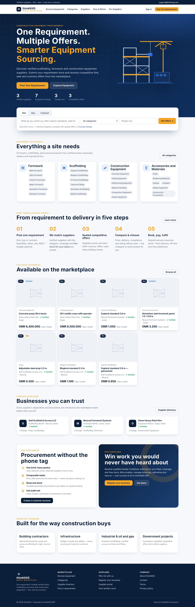
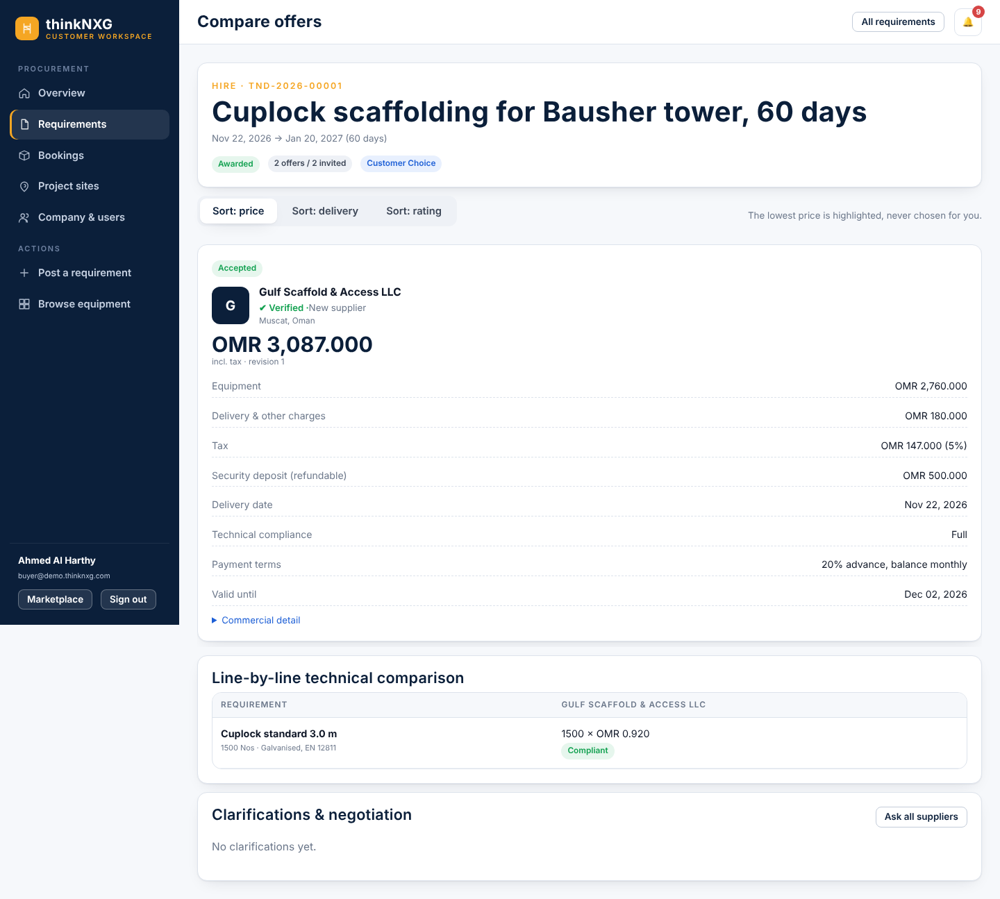
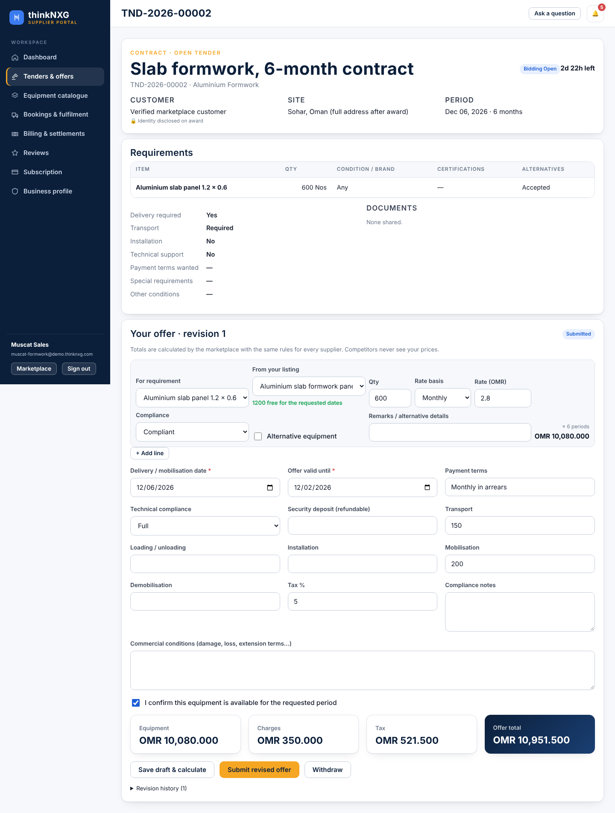
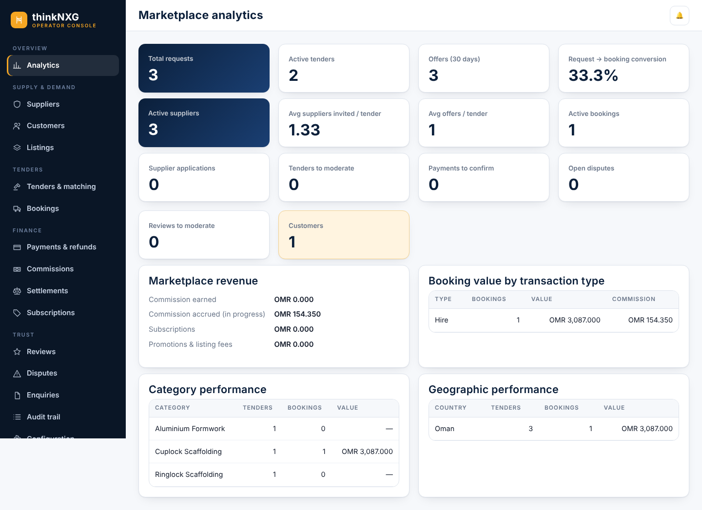

# thinkNXG Rental Marketplace

**One Requirement. Multiple Offers. Smarter Equipment Sourcing.**

A multi-vendor, request-driven tender & bidding marketplace for scaffolding, formwork and construction equipment —
**hire, sale and long-term contracts** — built as an independent Frappe v16 app on thinkNXG ERP (ERPNext v16), with an
optional bridge into thinkNXG Rental for fulfilment.

```
POST REQUIREMENT → CREATE TENDER → MATCH SUPPLIERS → RECEIVE OFFERS → COMPARE → SELECT → BOOK → PAY → FULFIL → SETTLE → REVIEW
```



| Customer: offer comparison | Supplier: tender & sealed offer | Operator: analytics |
|---|---|---|
|  |  |  |

## What's inside
* **48 DocTypes** — Marketplace Vendor / Vendor User / Verification / Location, Marketplace Customer & Project Sites,
  Marketplace Category (tree + attributes), Marketplace Listing (+ specs, images, availability ledger), Rental Request,
  Marketplace Tender, Tender Invitation, Supplier Offer (+ immutable Offer Revision), Tender Clarification, Offer
  Evaluation (+ criteria & scores), Marketplace Booking (+ schedule), Vendor Order, Marketplace Payment, Webhook Event,
  Commission Rule, Marketplace Commission, Marketplace Settlement, Subscription Plan, Vendor Subscription, Promotion,
  Review, Dispute, Notification, Audit Event, Enquiry, Settings.
* **Service layer** (`services/`) — requests, tender state machine, matching (availability-weighted), offers & revisions,
  evaluation & negotiation, transactional booking, fulfilment per model, Decimal pricing, commission rules, payments
  gateway abstraction (Manual / Stripe / Razorpay), subscriptions & entitlements, settlements, trust, audit, thinkNXG Rental bridge.
* **114 API endpoints** (`api/`) — public, customer, vendor, operator, files, webhooks. See [docs/05_API.md](docs/05_API.md).
* **Public website** — 13 pages incl. an 8-step guided requirement wizard.
* **Three portals** — customer workspace, supplier portal, operator console (vanilla JS SPAs, no build step — same approach as thinkNXG Rental).

## Quick start
```bash
bench get-app https://github.com/thinknxg/thinknxg-rental-marketplace --branch main
bench --site <site> install-app thinknxg_rental_marketplace
bench --site <site> execute thinknxg_rental_marketplace.demo.seed   # optional demo data
```
Open `/marketplace`. Full guide: [docs/03_INSTALL_DEPLOY.md](docs/03_INSTALL_DEPLOY.md).

## Sharing a bench or site with the car rental marketplace
This app can run on the same bench and the same site as `rental_marketplace`
([thinknxg/car_rental_marketplace](https://github.com/thinknxg/car_rental_marketplace)) **v1.1 or later**.
Earlier versions of that app used this app's module name (`Rental Marketplace`), four of its DocType names and three of
its role names, so the two could not be installed together; v1.1 renamed its side. What this app owns on a shared site:

* Module `Rental Marketplace`, all 48 DocTypes listed above, website pages under `/marketplace/…`
* Roles `Marketplace Admin`, `Marketplace Moderator`, `Marketplace Finance`, `Marketplace Vendor`, `Marketplace Customer`
  (the car app uses `Car Marketplace …` roles, so operator rights in one app grant nothing in the other)

```bash
bench get-app https://github.com/thinknxg/thinknxg-rental-marketplace --branch main
bench get-app https://github.com/thinknxg/car_rental_marketplace --branch main   # v1.1+
bench --site <site> install-app thinknxg_rental_marketplace
bench --site <site> install-app rental_marketplace                              # either order works
```

## Documentation
| | |
|---|---|
| [01 Source audit](docs/01_SOURCE_AUDIT.md) | What thinkNXG Rental does and what is reused |
| [02 Architecture](docs/02_ARCHITECTURE.md) | Layers, roles, state machines, concurrency, confidentiality, money |
| [03 Install & deploy](docs/03_INSTALL_DEPLOY.md) | Install, migrate, configure, production |
| [04 Security](docs/04_SECURITY.md) | Permissions, isolation, confidentiality, files, audit |
| [05 API](docs/05_API.md) | Endpoint reference |
| [06 Test results](docs/06_TEST_RESULTS.md) | 24/24 automated tests + browser end-to-end |
| [07 Known limitations](docs/07_KNOWN_LIMITATIONS.md) | What is not done yet |

## Acceptance criteria → evidence
| Criterion | Evidence |
|---|---|
| Multiple suppliers register; admins verify | `registration.register_vendor`, `/for-suppliers`; `vendors.set_status`, document review; `test_flow` setUp (4 suppliers) |
| Suppliers upload equipment; publish Hire / Sale / Contract listings | Supplier portal catalogue; `test_01`, `test_03` (sale), `test_04` (contract) |
| Customers create requirements; tenders generated; eligible suppliers invited | Wizard `/post-requirement`; `requests.submit → tender.create_from_request → publish → matching`; `test_01` asserts invitations & exclusions |
| Competing offers; confidentiality; comparison; clarifications; revisions | `offers.submit` + `Offer Revision`; sealed `compare`; `test_01`, `test_10` (reverse auction, negotiated counter-offer) |
| Accept → booking; availability reserved safely | `booking.accept_offer` with row locks + idempotency; `test_01`, `test_02` (no double allocation) |
| Existing rental workflows manage the confirmed hire | `rental_bridge` → Hire Order in thinkNXG Rental; `test_bridge` |
| Sale & contract follow their own workflows | `fulfilment.FLOWS`; `test_03`, `test_04` |
| Vendor & customer data isolated | Portal API checks + no DocType perms; `test_01` isolation asserts |
| Subscriptions & entitlements; commissions | `test_05`, `test_06`, commission asserted in `test_01` |
| Deadlines enforced; history auditable | `process_deadlines`; `TENDER_CLOSED` asserts; Audit Events asserted in `test_01` |
| Portals responsive | Desktop + 390 px screenshots in `docs/screenshots`, browser E2E |
| Installs on clean Frappe v16 + ERPNext v16 | Fresh `demo.test` site install + seed (see test results) |

## Licence & attribution
MIT — see [license.txt](license.txt). Rental lifecycle concepts come from thinkNXG Rental (thinknxg/ThinkNXG-Rental),
used at runtime only through the optional bridge. Built on thinkNXG Framework / thinkNXG ERP (Frappe Framework and
ERPNext, © Frappe Technologies, under their respective licences). No code, design or content from
`thinknxg/car_rental_marketplace` was used.

Sales: sales@kreatao.com · Docs: https://docs.thinknxg.com
